# Project Architecture & Dependency Knowledge Graph

> **Generated automatically for Google Gemini Code Assist and Graphify.**
> This graph maps every connected module node, reducing token usage by 95%.

```mermaid
graph TD
    %% Architectural Subgraphs
    subgraph Core Layer
        core/__init__
        core/config
        core/event_bus
        core/events
        core/input_keyboard
        core/logger
    end
    subgraph Vision & Camera Pipeline
        vision/__init__
        vision/action_detector
        vision/camera_manager
        vision/camera_supervisor
        vision/debug_tools
        vision/player_lock
        vision/pose_tracker
        vision/zone_calibration
    end
    subgraph Engine & Controller Bridge
        engine/__init__
        engine/audio
        engine/display
        engine/event_pump
        engine/game_engine
        engine/mechanics/__init__
        engine/mechanics/entities
        engine/mechanics/manager
        engine/motion_bridge
        engine/tutorial_ui
    end
    subgraph Identity & Economy
        identity/__init__
        identity/measurement_capture
        identity/profile_manager
        identity/shop_manager
    end
    subgraph Projection Output
        projection/projector_manager
    end
    subgraph Tools & Launchers
        tools/build_controller_exe
        tools/build_exe
        tools/calibrate_session
        tools/extract_module
        tools/generate_graph
        tools/inspect_cameras
        tools/make_session_diff
        tools/motion_controller_app
        tools/show_tree
        tools/update_git_commits
    end

    %% Connected Edges & Data Flow
    core/config -->|imports| core/logger
    core/event_bus -->|imports| core/events
    core/event_bus -->|imports| core/logger
    core/input_keyboard -->|imports| core/config
    core/input_keyboard -->|imports| core/event_bus
    core/input_keyboard -->|imports| core/events
    core/input_keyboard -->|imports| core/logger
    engine/audio -->|imports| core/config
    engine/audio -->|imports| core/event_bus
    engine/audio -->|imports| core/events
    engine/audio -->|imports| core/logger
    engine/display -->|imports| core/config
    engine/display -->|imports| core/event_bus
    engine/display -->|imports| core/events
    engine/display -->|imports| core/logger
    engine/event_pump -->|imports| core/logger
    engine/game_engine -->|imports| core/config
    engine/game_engine -->|imports| core/event_bus
    engine/game_engine -->|imports| core/events
    engine/game_engine -->|imports| core/logger
    engine/mechanics/__init__ -->|imports| engine/mechanics/entities
    engine/mechanics/__init__ -->|imports| engine/mechanics/manager
    engine/mechanics/manager -->|imports| core/config
    engine/mechanics/manager -->|imports| core/event_bus
    engine/mechanics/manager -->|imports| core/events
    engine/mechanics/manager -->|imports| core/logger
    engine/mechanics/manager -->|imports| engine/mechanics/entities
    engine/motion_bridge -->|imports| core/config
    engine/motion_bridge -->|imports| core/event_bus
    engine/motion_bridge -->|imports| core/events
    engine/motion_bridge -->|imports| core/logger
    engine/tutorial_ui -->|imports| core/events
    engine/tutorial_ui -->|imports| vision/pose_tracker
    identity/__init__ -->|imports| identity/profile_manager
    identity/measurement_capture -->|imports| core/config
    identity/measurement_capture -->|imports| core/event_bus
    identity/measurement_capture -->|imports| core/events
    identity/measurement_capture -->|imports| core/logger
    identity/measurement_capture -->|imports| identity/profile_manager
    identity/measurement_capture -->|imports| vision/pose_tracker
    identity/profile_manager -->|imports| core/config
    identity/profile_manager -->|imports| core/event_bus
    identity/profile_manager -->|imports| core/events
    identity/profile_manager -->|imports| core/logger
    identity/shop_manager -->|imports| core/config
    identity/shop_manager -->|imports| core/event_bus
    identity/shop_manager -->|imports| core/events
    identity/shop_manager -->|imports| core/logger
    identity/shop_manager -->|imports| identity/profile_manager
    projection/projector_manager -->|imports| core/config
    projection/projector_manager -->|imports| core/event_bus
    projection/projector_manager -->|imports| core/events
    projection/projector_manager -->|imports| core/logger
    tools/calibrate_session -->|imports| core/config
    tools/calibrate_session -->|imports| core/event_bus
    tools/calibrate_session -->|imports| core/events
    tools/calibrate_session -->|imports| core/logger
    tools/calibrate_session -->|imports| vision/action_detector
    tools/calibrate_session -->|imports| vision/camera_supervisor
    tools/calibrate_session -->|imports| vision/pose_tracker
    tools/motion_controller_app -->|imports| core/config
    tools/motion_controller_app -->|imports| core/event_bus
    tools/motion_controller_app -->|imports| core/logger
    tools/motion_controller_app -->|imports| engine/motion_bridge
    tools/motion_controller_app -->|imports| engine/tutorial_ui
    tools/motion_controller_app -->|imports| vision/action_detector
    tools/motion_controller_app -->|imports| vision/camera_configurator
    tools/motion_controller_app -->|imports| vision/camera_supervisor
    tools/motion_controller_app -->|imports| vision/player_lock
    tools/motion_controller_app -->|imports| vision/pose_tracker
    tools/motion_controller_app -->|imports| vision/zone_calibration
    vision/__init__ -->|imports| vision/camera_manager
    vision/action_detector -->|imports| core/config
    vision/action_detector -->|imports| core/event_bus
    vision/action_detector -->|imports| core/events
    vision/action_detector -->|imports| core/logger
    vision/action_detector -->|imports| vision/pose_tracker
    vision/camera_manager -->|imports| core/config
    vision/camera_manager -->|imports| core/event_bus
    vision/camera_manager -->|imports| core/events
    vision/camera_manager -->|imports| core/logger
    vision/camera_supervisor -->|imports| core/config
    vision/camera_supervisor -->|imports| core/event_bus
    vision/camera_supervisor -->|imports| core/events
    vision/camera_supervisor -->|imports| core/logger
    vision/camera_supervisor -->|imports| vision/camera_manager
    vision/debug_tools -->|imports| core/config
    vision/debug_tools -->|imports| core/event_bus
    vision/debug_tools -->|imports| core/events
    vision/debug_tools -->|imports| core/logger
    vision/player_lock -->|imports| core/config
    vision/player_lock -->|imports| core/event_bus
    vision/player_lock -->|imports| core/events
    vision/player_lock -->|imports| core/logger
    vision/player_lock -->|imports| vision/pose_tracker
    vision/player_lock -->|imports| vision/zone_calibration
    vision/pose_tracker -->|imports| core/config
    vision/pose_tracker -->|imports| core/event_bus
    vision/pose_tracker -->|imports| core/events
    vision/pose_tracker -->|imports| core/logger
    vision/zone_calibration -->|imports| core/config
    vision/zone_calibration -->|imports| core/event_bus
    vision/zone_calibration -->|imports| core/events
    vision/zone_calibration -->|imports| core/logger
    vision/zone_calibration -->|imports| vision/pose_tracker
```

---
Run `python tools/generate_graph.py` anytime code changes to refresh this graph!
