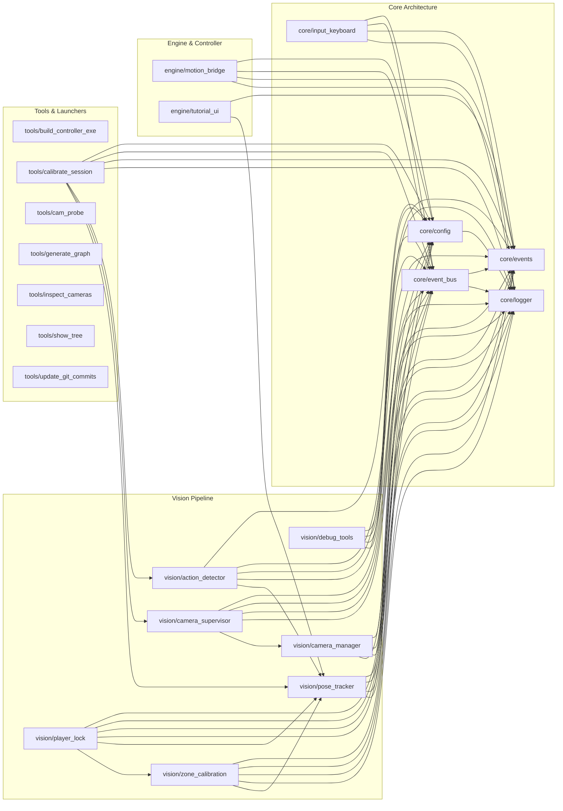

# Project Architecture & Dependency Knowledge Graph

> **Generated automatically for Google Gemini and Graphify.**
> Maps every connected module node with zero token waste.

---
Run `python tools/generate_graph.py` anytime code changes to refresh this graph!
